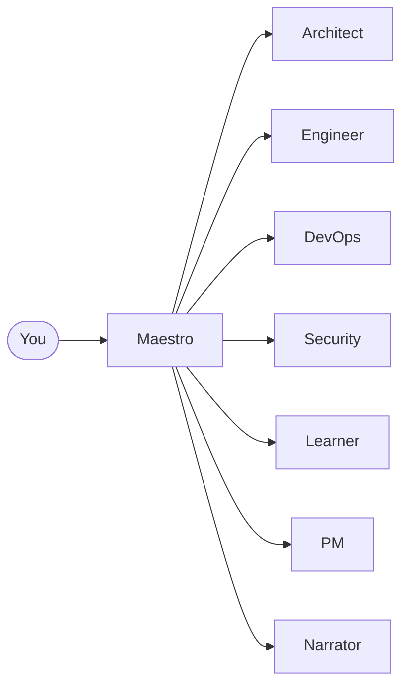

# Carter

[](https://github.com/mauriciomem/carter-ai/actions/workflows/ci.yml)

Carter turns [OpenCode](https://opencode.ai/v2/docs/) into a small team of AI
specialists: an architect, an engineer, a DevOps engineer, a security reviewer and
more, coordinated by one orchestrator called **Maestro**.

You describe the work in plain language. Maestro hands it to the right specialist,
and anything risky (a push, a `terraform apply`) waits for your approval.

## Why Carter

- **Specialists, not a generalist.** Each agent has its own instructions, model and
  permissions, so answers stay focused on one domain.
- **Safe by default.** Agents ask before risky actions, and only the DevOps agent can
  change infrastructure. No agent pushes: you do, with `carter push`.
- **Writes stay under your control.** Commits, pull requests and Jira updates are
  shown as a plan first and run only after you say yes.
- **It remembers.** Lessons, decisions and plans are saved as plain Markdown files
  that you can read and edit.

## What you get



| Agent | Ask it about |
|-------|--------------|
| **Maestro** | Anything. It answers simple questions itself and routes the rest |
| **Architect** | System design, cloud architecture, trade-offs, decision records |
| **Engineer** | Code, tests, refactoring, code review |
| **DevOps** | CI/CD, Terraform, containers, git. Prepares the handoff; you push |
| **Security** | Threat models, secure code review, vulnerability triage |
| **Learner** | Explanations and research, with sources |
| **PM** | Plans, roadmaps, risks |
| **Narrator** | PR descriptions, Jira comments, docs and announcements, with secrets and internal details removed |

Carter also ships 27 **skills**: step-by-step playbooks (Terraform, Go, threat
modeling, Jira, and more) that an agent loads only when the task needs one.

## Install

You need Python 3.11+, [uv](https://docs.astral.sh/uv/) and OpenCode 2.1 or newer.

```bash
uv tool install git+https://github.com/mauriciomem/carter-ai.git
carter install
```

> [!TIP]
> `carter: command not found`? Run `uv tool update-shell` and open a new terminal.

`carter install` writes the agents and skills to `~/.config/opencode/`, so they
work in every project. Details, upgrades and removal are in the
[install guide](docs/guides/install.md).

## First run

1. Start `opencode` in any project directory.
2. Switch to **carter-maestro**: press `Shift+Tab` until it is selected, or pick it
   from `/agents` (`Ctrl+X` then `A`).
3. Ask for something:

```text
Design a REST API for a task-management app.
Use carter-security to review src/auth.py.
ops: create a feature branch, commit my changes and open a pull request.
```

The specialists run as subagents, so you reach them through Maestro by naming them
or simply describing the task. The `ops:` prefix starts the
[approval flow for write operations](docs/guides/write-operations.md).

## Global install or per-project workspace

| | Global (`carter install`) | Workspace (`carter init`) |
|---|---|---|
| Where | `~/.config/opencode/` | `.opencode/agents/` in one project |
| Settings | Shipped defaults | Your `.carter/carter.yaml` (models, safety level, …) |
| Extras | — | Plans, session checkpoints and project knowledge in `.carter/` |

Start with the global install. Add a workspace when a project needs its own settings
or memory: see [Your first workspace](docs/guides/first-workspace.md).

## Safety in one paragraph

Every agent starts from "ask before doing anything". Reading and searching are free.
Local edits are allowed only for agents that need them. Pushing and every GitHub write
are yours (`carter push`, `carter pr`); publishing to Jira and Slack and Vault secret
reads are reserved for DevOps and always ask. Destructive or
infrastructure-changing commands ask too, and in `strict` mode they are blocked
outright. OpenCode enforces these rules, not the model. Read
[Safety and permissions](docs/guides/safety-and-permissions.md) for the details and
the limits.

## Documentation

Start with the [docs index](docs/README.md). The most useful pages:

- [Using Carter](docs/guides/using-carter.md) · [Safety](docs/guides/safety-and-permissions.md) ·
  [Write operations](docs/guides/write-operations.md) · [Identity and signing](docs/guides/identity-and-signing.md) · [MCP servers](docs/guides/mcp-servers.md)
- [CLI](docs/reference/cli.md) · [Configuration](docs/reference/configuration.md) ·
  [Troubleshooting](docs/troubleshooting.md) · [Contributing](docs/contributing/development.md)

## License

`GPL-3.0-only`. See [LICENSE](LICENSE).
