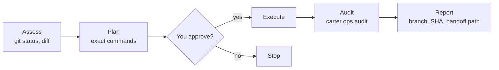

# Write operations (`ops:`)

Start a request with `ops:` and Carter follows a fixed approval flow for anything
that changes Git or Jira: it shows you the exact commands first and runs them only
after you agree. **Pushing and every other GitHub write are yours:** no agent pushes,
opens a pull request or posts to GitHub. The agent prepares a handoff and you run
`carter push` and `carter pr` yourself (see [Pushing and pull requests](#pushing-and-pull-requests-the-handoff)).

```text
ops: create a feature branch, commit my changes and write the pull request handoff
```

## The flow



1. **Assess.** The agent reads the current state (`git status`, `git diff`,
   `git log`). No approval needed.
2. **Plan.** It shows the operation, the files, the message and every command.
3. **Approve.** Nothing is written until you say yes.
4. **Execute.** It runs the commands in the terminal, as you would.
5. **Audit.** It records the result with `carter ops audit`.
6. **Report.** It tells you what happened: branch, commit SHA and, for a finished
   branch, the handoff file and the commands to run in your own terminal.

Reads such as `git log` or `gh pr list` don't need `ops:`.

## Who runs which step

| Step | Who |
|------|-----|
| Local: branch, `git add`, `git commit` | The agent that received `ops:`. Maestro, Architect and Learner hold no local-write permission, so OpenCode asks you first |
| Push, pull requests, issues, comments, reviews, releases, merges | **You**, in your own terminal. No agent has a path to them, DevOps included |
| The handoff file for a finished branch | DevOps (or the agent you asked), with its file tools |
| Jira writes (through the `carter-atlassian` MCP server) | DevOps, by the skill's routing. OpenCode asks you before every MCP call, in any agent |
| Text that leaves your machine (PR bodies, Jira comments, release notes) | Drafted by the Narrator, which removes secrets and internal details; Jira text is then sent by DevOps, GitHub text goes in the handoff or comes to you as a draft |

OpenCode enforces the restriction for shell commands: `git push` and the `gh` write
commands are denied to every agent, and `gh api` is denied outright. Jira writes are MCP
tool calls, which have no specific rule: any agent could make one, but OpenCode asks you
first. Keeping them with DevOps, and the Narrator step, are instructions the agents
follow; see [the limits](safety-and-permissions.md#know-the-limits).

## Pushing and pull requests (the handoff)

When a branch is ready, the agent stops at the commit and writes one file in the
workspace, then tells you what to run:

1. **The agent writes the handoff**, `.carter/state/handoff/<encoded-branch>.md`, where
   `feat/x` becomes `feat%2Fx.md`. Front matter, then the pull request body in Markdown:

   ```markdown
   ---
   title: "feat(auth): add token refresh"
   base: main
   draft: false
   head_sha: 0123456789abcdef0123456789abcdef01234567
   repo: owner/name
   ---

   ## Summary
   - what changed and why
   ```

   Only these five keys are accepted. The file is untrusted input from a model and never
   becomes a command line; it must hold no secrets. It is not part of the workspace's
   saved history.
2. **You run `carter push`** in your own terminal, from the repository:

   ```bash
   carter push --dry-run     # show what would be pushed and asked; push nothing
   carter push               # show it, then ask
   ```

   It fetches the target ref, lists the commits, the files and any hook or CI paths
   (`.husky/`, `.github/workflows/` and similar) in red, notes GitHub's branch
   protection when your read-only token can see it, and asks `y`. On the default branch
   you type the branch name instead. It pushes only `HEAD` to the same-named branch on
   `origin`. Commits whose committer is the LLM must carry a valid LLM signature, or it
   refuses. Repository or SSH settings that could run code with your credentials are shown
   first and you decide.
3. **You run `carter pr`** in your own terminal:

   ```bash
   carter pr
   ```

   It reads only the handoff for the current branch, scans it for secrets, finds the
   target (the parent repository if `origin` is a fork), shows the title, base and the
   first 40 lines of the body, asks `y/N`, then runs `gh pr create` with your own `gh`
   login. If the branch is not on `origin` yet it offers the push first. The handoff is
   deleted only after the pull request exists.

There are no options for forcing, pushing tags, naming another remote or passing git
flags. **Run both in your own terminal.** They refuse in an agent shell and in any shell
without a terminal, including OpenCode's `!` shell, and say so. Errors you may meet:
`E-HUMAN-TERMINAL`, `E-HANDOFF` (no valid file, or `head_sha` is not part of the branch),
`E-SECRET-SCAN` (the title, branch or body looks like a credential), `E-B-UNSIGNED`.
See [Troubleshooting](../troubleshooting.md#guards).

> [!WARNING]
> **A plain `git push` typed into OpenCode's `!` prompt is an unvalidated fallback.** It
> runs with your credentials but none of the checks above. It must be **typed**; never
> paste a line that starts with `!`, because a pasted one is sent to the model instead of
> your shell.

## Attribution

You stay the author of everything. Without a signing key for the LLM (tiers T0 and T1),
agent commits use your own git config and are unsigned. **With one (tier T2), the LLM is the
committer and signs the commit with its own key, while you stay the author.** Carter never
asks git to sign with *your* key. Setting this up is described in
[Identity and signing](identity-and-signing.md).

- **Commits** use your `git config user.name` and email as the author, and as the committer
  below T2. The agent never passes `--author`, `--no-verify`, `-s`, `-S` or any signing
  option, and never adds `Signed-off-by` unless you ask for it on that commit. Carter is
  credited only with the trailer that `carter ops config --emit` prints, which depends on
  the tier:

  | Tier | What is configured | Trailer |
  |------|--------------------|---------|
  | T0 | nothing | `Assisted-by: Carter` (no email) |
  | T1 | an LLM GitHub account, no key | `Co-authored-by: <login> <id+login@users.noreply.github.com>` |
  | T2 | account and signing key | `Co-authored-by: <login> <id+login@users.noreply.github.com>`; the commit is also signed by the LLM key |

  ```bash
  git add src/auth.py
  git commit -m "feat(auth): add token refresh" --trailer "Assisted-by: Carter"
  git log -1 --format='%an|%cn|%G?'    # you|you|N
  ```

  In the opt-in role `author` (T2 only) the LLM is also the author, the trailer is **your**
  `Co-authored-by: <user.name> <user.email>`, and the last line reads `LLM|LLM|G`; see
  [Identity and signing](identity-and-signing.md#role-author-the-llm-is-the-author). It is refused
  (never downgraded) below T2 or when your own git identity is unusable (`E-HUMAN-IDENTITY`).

  The agent checks that last line. Below T2 the author and committer are you and the
  signature status is `N` (unsigned). At T2 the committer is the LLM identity and the status
  is `G` or `E` (a signature exists), never `N`. If the emit says `commits: refused`, the agent
  stops and tells you why instead of committing. If the LLM key is locked, the commit fails,
  your changes stay staged, and the agent asks you to run `carter identity unlock`.
- **GitHub** pull requests are created by `carter pr` with your own `gh` login. There is
  no agent path for issues, comments, reviews or releases: the agent gives you the text,
  ending with the `footer` from the same command (default
  `_This comment was generated with Carter._`), and you post it.
- **Jira** comments are written through the `carter-atlassian`
  [MCP server](mcp-servers.md), with your Atlassian login, and end with the same footer.

Commit messages, branch names and PR text are always in English, whatever language
you chat in.

## Setup

`carter install` creates `~/.carter/config.toml` the first time. By default it holds no
LLM identity, so you are at T0 and nothing else is needed. An older file is migrated once
(see [Install](install.md#upgrade)); the full format is in the
[configuration reference](../reference/configuration.md#user-config-carterconfigtoml).

- `carter install --bot-name` is deprecated and ignored.
- The old `signing_key` setting is dropped; Carter never reads your signing key. The LLM's own key is set up with `carter identity add` ([guide](identity-and-signing.md)).
- `carter pr` uses `gh` with your own login, so run `gh auth login` first.

> [!WARNING]
> `gh` uses `GH_TOKEN` or `GITHUB_TOKEN` from the environment instead of your
> `gh auth login` credentials (`gh help environment`). Carter's read-only GitHub token
> lives in a file, not in the environment, so that it never reaches `gh`. If your shell
> still exports a read-only token as `GITHUB_TOKEN` (older instructions suggested it),
> remove it: `carter pr` would use it and GitHub would refuse the write. `carter pr`
> prints a notice naming such a variable.

## What this release does and does not do

Without the plugin (before you confirm `g2` revision 2) the guards are **a speed bump**:
policies are literal command matches, not a boundary, and agent shells still inherit your SSH
agent and `gh` login. The read-only GitHub token (`carter github-token set`) is stored but
not injected into agent shells: only the `carter-github` MCP server reads the file. Agent
commits still use your own git config. `carter check --host` says "plugin not installed" for
as long as that is true.

With the plugin (see [Install: the plugin](install.md#the-plugin-g2-revision-2)) the shell
isolation applies: every agent shell is isolated and a command gate rejects what the literal matches cannot see. Pushing and
pull requests are still yours: the agent writes the handoff file, you run `carter push` and
`carter pr`. Agent commits are made with your name as the author and the trailer below: unsigned
below T2, signed by the LLM identity at T2. If your effective tier is T2 and anything needed for
signing is missing (the key is not unlocked, the shim changed, the config is broken), the
commit **fails and stays staged**; it is never made unsigned. To let agents commit unsigned in a
workspace, set `max_tier = "t1"` for it (see the
[configuration reference](../reference/configuration.md#user-config-carterconfigtoml)). The
limits of all this are listed in
[Safety and permissions](safety-and-permissions.md#what-the-guards-cannot-do).

To see the values the agents use:

```bash
carter ops config --emit
```

```json
{
  "tier": "t0",
  "role": "co-author",
  "role_source": "default",
  "coauthor_trailer": "Assisted-by: Carter",
  "commits": "allowed",
  "refusal_reason": "",
  "footer": "_This comment was generated with Carter._",
  "has_github_token": false
}
```

## Audit log

Every operation and every recorded [policy exception](safety-and-permissions.md#record-an-exception)
is appended to `~/.carter/audit.log`, one JSON object per line:

```json
{"timestamp": "2026-10-25T12:06:06.496537+00:00", "operation": "git-flow", "phase": "execute", "result": "success", "params": {"branch": "feature/x"}}
```

Logging is best-effort; a failed write never blocks the operation. Your Git, GitHub
and Jira history remain the real record. The command details are in the
[CLI reference](../reference/cli.md#carter-ops).

## Next

- [Safety and permissions](safety-and-permissions.md)
- [MCP servers](mcp-servers.md): including the read-only GitHub token
