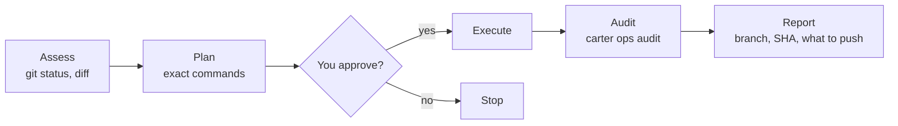

# Write operations (`ops:`)

Start a request with `ops:` and Carter follows a fixed approval flow for anything
that changes Git or Jira: it shows you the exact commands first and runs them only
after you agree. **Pushing is yours:** no agent pushes. You run `carter push` yourself;
then the agent can open the pull request with `gh pr create` (see
[Pushing and pull requests](#pushing-and-pull-requests)). Merging is yours too.

```text
ops: create a feature branch and commit my changes
```

## The flow



1. **Assess.** The agent reads the current state (`git status`, `git diff`,
   `git log`). No approval needed.
2. **Plan.** It shows the operation, the files, the message and every command.
3. **Approve.** Nothing is written until you say yes.
4. **Execute.** It runs the commands in the terminal, as you would.
5. **Audit.** It records the result with `carter ops audit`.
6. **Report.** It tells you what happened: branch, commit SHA and, for a finished
   branch, the command to run (`carter push`) and, once you pushed, the pull request.

Reads such as `git log` or `gh pr list` don't need `ops:`.

## Who runs which step

| Step | Who |
|------|-----|
| Local: branch, `git add`, `git commit` | The agent that received `ops:`. Maestro, Architect and Learner hold no local-write permission, so OpenCode asks you first |
| Push | **You**, in your terminal or OpenCode's `!` shell. No agent has a path to it, DevOps included (DevOps may *ask* you to approve it, see [Push tool](push-and-pr-tools.md)) |
| Open, edit and comment on a pull request | Any Carter agent, with `gh pr create`, `gh pr edit` and `gh pr comment`, once you pushed the branch |
| Merge, close, review or ready a pull request; issues; releases | **You**. No agent has a path to them |
| Jira writes (through the `carter-atlassian` MCP server) | DevOps, by the skill's routing. OpenCode asks you before every MCP call, in any agent |
| Text that leaves your machine (PR bodies, Jira comments, release notes) | Drafted by the Narrator, which removes secrets and internal details; Jira text is then sent by DevOps, PR text with `gh`, release notes come to you as a draft |

OpenCode enforces the restriction for shell commands: `git push`, `gh pr merge`, `close`,
`review` and `ready`, the `gh issue` and `gh release` write commands are denied to every
Carter agent, and `gh api` is denied outright. Jira writes are MCP
tool calls, which have no specific rule: any agent could make one, but OpenCode asks you
first. Keeping them with DevOps, and the Narrator step, are instructions the agents
follow; see [the limits](safety-and-permissions.md#know-the-limits).

## Pushing and pull requests

When a branch is ready, the agent stops at the commit and tells you what to run:

1. **You run `carter push`** from the repository, in your terminal or as `!carter push` in
   OpenCode:

   ```bash
   carter push --dry-run     # check and show; push nothing
   carter push               # push
   # ✓ feat/auth → origin · 1 commit (signed)
   ```

   It asks nothing. It fetches the target ref, counts the commits, checks the files and any
   hook or CI paths (`.husky/`, `.github/workflows/` and similar), and pushes only `HEAD` to the
   same-named branch on `origin` (the default branch too: nothing to type). Commits whose
   committer is the LLM must carry a valid LLM signature, or it refuses. Repository or SSH
   settings that could run code with your credentials, and risky paths, are named in one
   warning line; the push goes on. `-v` lists the commits and files.
2. **The agent opens the pull request** with `gh pr create --head <branch>`, using the
   read-only GitHub token (see [MCP servers](mcp-servers.md#the-github-token)): add
   `Pull requests: write` to it and keep `Contents` read, and it can open, edit and comment
   on PRs but cannot push or merge. `carter github-token check` says whether the PR
   permission is there. The branch must already be on `origin`: that is why you push first.
3. **You decide what happens to the PR.** Merging, closing, reviewing and marking it ready
   are yours; the agent has no path to them.

There are no options for forcing, pushing tags, naming another remote or passing git
flags. **`carter push` is for you, not an agent.** It refuses in an agent shell and says so.
OpenCode's `!` shell is yours once the plugin has tagged it (no terminal is needed there).
Errors you may meet: `E-HUMAN-TERMINAL`, `E-B-UNSIGNED`. See
[Troubleshooting](../troubleshooting.md#guards).

**An optional shortcut for devops (B).** If you confirmed the B tool
([Push tool](push-and-pr-tools.md)), the devops agent can instead *ask* you to approve one
push in OpenCode's own prompt. It is stricter than `carter push` in what it
refuses (the default branch, HTTPS, unsigned LLM commits, risky config) and you still click for every
use. Everything else on this page stays as it is.

> [!WARNING]
> **A plain `git push` typed into OpenCode's `!` prompt is an unvalidated fallback.** It
> runs with your credentials but none of the checks above; use `!carter push` instead. Type
> such lines yourself; never paste a line that starts with `!`, because a pasted one is sent
> to the model instead of your shell.

## Attribution

You stay the author of everything. Without a signing key for the LLM (tiers T0 and T1),
agent commits use your own git config and are unsigned. **With one (tier T2), the LLM is the
committer and signs the commit with its own key, while you stay the author.** Carter never
asks git to sign with *your* key. Setting this up is described in
[Identity and signing](identity-and-signing.md).

- **Commits** use your `git config user.name` and email as the author, and as the committer
  below T2. The agent never passes `--author`, `--no-verify`, `-s`, `-S` or any signing
  option, and never adds `Signed-off-by` unless you ask for it on that commit. Carter is
  credited only with the trailer that `carter ops config --emit` prints, which depends on
  the tier:

  | Tier | What is configured | Trailer |
  |------|--------------------|---------|
  | T0 | nothing | `Assisted-by: Carter` (no email) |
  | T1 | an LLM GitHub account, no key | `Co-authored-by: <login> <id+login@users.noreply.github.com>` |
  | T2 | account and signing key | `Co-authored-by: <login> <id+login@users.noreply.github.com>`; the commit is also signed by the LLM key |

  ```bash
  git add src/auth.py
  git commit -m "feat(auth): add token refresh" --trailer "Assisted-by: Carter"
  ```

  At T2 the agent then runs `carter identity verify --commit HEAD --quiet` (exit 0 means the
  commit is signed by the LLM key) and tells you one line: `Committed 4f9c2ab: feat(auth): add
  token refresh`. In the opt-in role `author` (T2 only) the LLM is also the author, the trailer
  is **your** `Co-authored-by: <user.name> <user.email>`; see
  [Identity and signing](identity-and-signing.md#role-author-the-llm-is-the-author). It is refused
  (never downgraded) below T2 or when your own git identity is unusable (`E-HUMAN-IDENTITY`).

  Below T2 the author and committer are you and the commit is unsigned. At T2 the committer
  is the LLM identity and the commit is signed. If the emit says `commits: refused`, the agent
  stops and tells you why instead of committing. If the LLM key is locked, the commit fails,
  your changes stay staged, and the agent asks you to run `carter identity unlock`.
- **GitHub** pull requests are opened, edited and commented on by the agent with `gh`, and end
  with the `footer` from the same command (default `_This comment was generated with Carter._`).
  There is no agent path for issues, reviews, merges or releases: the agent gives you the text
  and you post it.
- **Jira** comments are written through the `carter-atlassian`
  [MCP server](mcp-servers.md), with your Atlassian login, and end with the same footer.

Commit messages, branch names and PR text are always in English, whatever language
you chat in.

## Setup

`carter install` creates `~/.carter/config.toml` the first time. By default it holds no
LLM identity, so you are at T0 and nothing else is needed. A key Carter does not know
is listed by `carter check --host`, `install` and `update` with the file it is in; delete it
(see [Configuration](../reference/configuration.md#user-config-carterconfigtoml)).

- Carter never reads your signing key. The LLM's own key is set up with `carter identity add` ([guide](identity-and-signing.md)).
- Opening a pull request needs the GitHub token to carry `Pull requests: write`
  ([MCP servers](mcp-servers.md#the-github-token)).

> [!WARNING]
> `gh` uses `GH_TOKEN` or `GITHUB_TOKEN` from the environment instead of your
> `gh auth login` credentials (`gh help environment`). Carter's GitHub token lives in a
> file, not in the environment, so that it never reaches `gh` in your terminal. If your
> shell exports a token as `GITHUB_TOKEN`, your own `gh` commands use it too.

## What this release does and does not do

Without the plugin (before you confirm `g2` revision 2) the guards are **a speed bump**:
policies are literal command matches, not a boundary, and agent shells still inherit your SSH
agent and `gh` login. The read-only GitHub token (`carter github-token set`) is stored but
not injected into agent shells: only the `carter-github` MCP server reads the file. Agent
commits still use your own git config. `carter check --host` says "plugin not installed" for
as long as that is true.

With the plugin (see [Install: the plugin](install.md#the-plugin-g2-revision-2)) the shell
isolation applies: every Carter agent shell is isolated and a command gate rejects what the
literal matches cannot see. Pushing is still yours: you run `carter push`; the agent then opens
the pull request. Agent commits are made with your name as the author and the trailer below: unsigned
below T2, signed by the LLM identity at T2. If your effective tier is T2 and anything needed for
signing is missing (the key is not unlocked, the shim changed, the config is broken), the
commit **fails and stays staged**; it is never made unsigned. To let agents commit unsigned in a
workspace, set `max_tier = "t1"` for it (see the
[configuration reference](../reference/configuration.md#user-config-carterconfigtoml)). The
limits of all this are listed in
[Safety and permissions](safety-and-permissions.md#what-the-guards-cannot-do).

To see the values the agents use:

```bash
carter ops config --emit
```

```json
{
  "tier": "t0",
  "role": "co-author",
  "role_source": "default",
  "coauthor_trailer": "Assisted-by: Carter",
  "commits": "allowed",
  "refusal_reason": "",
  "footer": "_This comment was generated with Carter._",
  "has_github_token": false
}
```

## Audit log

Every operation and every recorded [policy exception](safety-and-permissions.md#record-an-exception)
is appended to `~/.carter/state/audit/audit.log`, one JSON object per line:

```json
{"timestamp": "2026-10-25T12:06:06.496537+00:00", "operation": "git-flow", "phase": "execute", "result": "success", "params": {"branch": "feature/x"}}
```

Logging is best-effort; a failed write never blocks the operation. Your Git, GitHub
and Jira history remain the real record. The command details are in the
[CLI reference](../reference/cli.md#carter-ops).

## Next

- [Safety and permissions](safety-and-permissions.md)
- [MCP servers](mcp-servers.md): including the read-only GitHub token
