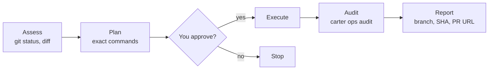

# Write operations (`ops:`)

Start a request with `ops:` and Carter follows a fixed approval flow for anything
that changes Git, GitHub or Jira: it shows you the exact commands first and runs
them only after you agree.

```text
ops: create a feature branch, commit my changes and open a pull request
```

## The flow



1. **Assess.** The agent reads the current state (`git status`, `git diff`,
   `git log`). No approval needed.
2. **Plan.** It shows the operation, the files, the message and every command.
3. **Approve.** Nothing is written until you say yes.
4. **Execute.** It runs the commands in the terminal, as you would.
5. **Audit.** It records the result with `carter ops audit`.
6. **Report.** It tells you what happened: branch, commit SHA, PR or issue URL.

Reads such as `git log` or `gh pr list` don't need `ops:`.

## Who runs which step

| Step | Who |
|------|-----|
| Local: branch, `git add`, `git commit` | The agent that received `ops:`. Maestro, Architect and Learner hold no local-write permission, so OpenCode asks you first |
| Remote: `git push`, PRs, issues, comments, releases | **DevOps only.** Other agents stop after the local steps and hand over |
| Jira writes (through the `carter-atlassian` MCP server) | DevOps, by the skill's routing. OpenCode asks you before every MCP call, in any agent |
| Text that leaves your machine (PR bodies, Jira comments, release notes) | Drafted by the Narrator, which removes secrets and internal details, then sent by DevOps |

OpenCode enforces the DevOps restriction only for shell commands: `git push` and the
`gh` write commands are denied to every other agent. Jira writes are MCP tool calls,
which have no specific rule: any agent could make one, but OpenCode asks you first.
Keeping them with DevOps, and the Narrator step, are instructions the agents follow;
see [the limits](safety-and-permissions.md#know-the-limits).

## Attribution

You stay the author of everything. **Until Carter can sign with a separate LLM identity
(a later release), agent commits use your own git config and are unsigned.** That is the
same author and committer as before, minus the signature: Carter no longer asks git to
sign with your key.

- **Commits** use your `git config user.name` and email for both author and committer.
  The agent never passes `--author`, `--no-verify`, `-s` or `-S`, and never adds
  `Signed-off-by` unless you ask for it on that commit. Carter is credited only with the
  trailer that `carter ops config --emit` prints, which depends on the tier:

  | Tier | What is configured | Trailer |
  |------|--------------------|---------|
  | T0 | nothing | `Assisted-by: Carter` (no email) |
  | T1 | an LLM GitHub account, no key | `Co-authored-by: <login> <id+login@users.noreply.github.com>` |
  | T2 | account and signing key | the same trailer for now; signing arrives later |

  ```bash
  git add src/auth.py
  git commit -m "feat(auth): add token refresh" --trailer "Assisted-by: Carter"
  git log -1 --format='%an|%cn|%G?'    # you|you|N
  ```

  The agent checks that last line: author and committer are you and the signature
  status is `N` (unsigned). If the emit says `commits: refused`, the agent stops and
  tells you why instead of committing.
- **GitHub** issues, PRs and comments are posted with your `gh` login and end with the
  `footer` from the same command (default `_This comment was generated with Carter._`).
- **Jira** comments are written through the `carter-atlassian`
  [MCP server](mcp-servers.md), with your Atlassian login, and end with the same footer.

Commit messages, branch names and PR text are always in English, whatever language
you chat in.

## Setup

`carter install` creates `~/.carter/config.toml` the first time. By default it holds no
LLM identity, so you are at T0 and nothing else is needed. An older file is migrated once
(see [Install](install.md#upgrade)); the full format is in the
[configuration reference](../reference/configuration.md#user-config-carterconfigtoml).

- `carter install --bot-name` is deprecated and ignored.
- The old `signing_key` setting is dropped; Carter never reads your signing key.
- GitHub writes use `gh`, so log in with `gh auth login` first.

> [!WARNING]
> `gh` uses `GH_TOKEN` or `GITHUB_TOKEN` from the environment instead of your
> `gh auth login` credentials (`gh help environment`). If you export `GITHUB_TOKEN`
> for the [GitHub MCP server](mcp-servers.md), `gh` writes use that token too. Give it
> the write scopes you need, or don't export it globally (set it only for the
> environment that starts OpenCode).

To see the values the agents use:

```bash
carter ops config --emit
```

```json
{
  "tier": "t0",
  "role": "co-author",
  "role_source": "default",
  "coauthor_trailer": "Assisted-by: Carter",
  "commits": "allowed",
  "refusal_reason": "",
  "footer": "_This comment was generated with Carter._",
  "has_github_token": false
}
```

## Audit log

Every operation and every recorded [policy exception](safety-and-permissions.md#record-an-exception)
is appended to `~/.carter/audit.log`, one JSON object per line:

```json
{"timestamp": "2026-10-25T12:06:06.496537+00:00", "operation": "git-flow", "phase": "execute", "result": "success", "params": {"branch": "feature/x"}}
```

Logging is best-effort; a failed write never blocks the operation. Your Git, GitHub
and Jira history remain the real record. The command details are in the
[CLI reference](../reference/cli.md#carter-ops).

## Next

- [Safety and permissions](safety-and-permissions.md)
- [MCP servers](mcp-servers.md)
