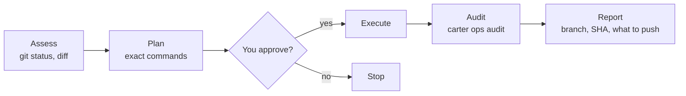

# Write operations (`ops:`)

Start a request with `ops:` and Carter follows a fixed approval flow for anything
that changes Git or Jira: it shows you the exact commands first and runs them only
after you agree. **Pushing is yours:** no agent pushes. You run `carter push`; then
the agent can open the pull request with `gh pr create`. Merging is yours too.

```text
ops: create a feature branch and commit my changes
```

## The flow



1. **Assess.** The agent reads the current state (`git status`, `git diff`,
   `git log`). No approval needed.
2. **Plan.** It shows the operation, the files, the message and every command.
3. **Approve.** Nothing is written until you say yes.
4. **Execute.** It runs the commands in the terminal, as you would.
5. **Audit.** It records the result with `carter ops audit`.
6. **Report.** It tells you what happened in a line or two: branch, commit SHA and, for a
   finished branch, the command to run (`carter push`).

Reads such as `git log` or `gh pr list` don't need `ops:`.

## Who runs which step

| Step | Who |
|------|-----|
| Local: branch, `git add`, `git commit` | The agent that received `ops:`. Maestro, Architect and Learner hold no local-write permission, so OpenCode asks you first |
| Push | **You**, with `carter push` in your terminal or OpenCode's `!` shell. DevOps may *ask* you to approve it ([below](#letting-devops-ask-you-to-push)) |
| Open, edit and comment on a pull request | Any Carter agent, with `gh pr create`, `gh pr edit` and `gh pr comment`, once the branch is on `origin` |
| Merge, close, review or ready a pull request; issues; releases | **You**. No agent has a path to them |
| Jira writes (through the `carter-atlassian` MCP server) | DevOps, by the skill's routing. OpenCode asks you before every MCP call, in any agent |
| Text that leaves your machine (PR bodies, Jira comments, release notes) | Drafted by the Narrator, which removes secrets and internal details; Jira text is then sent by DevOps, PR text with `gh`, release notes come to you as a draft |

OpenCode enforces the restriction for shell commands: `git push`, `gh pr merge`, `close`,
`review` and `ready`, the `gh issue` and `gh release` write commands are denied to every
Carter agent, and `gh api` is denied outright. Jira writes are MCP tool calls, which have no
specific rule: any agent could make one, but OpenCode asks you first. Keeping them with DevOps,
and the Narrator step, are instructions the agents follow; see
[the limits](safety-and-permissions.md#know-the-limits).

## Pushing and pull requests

When a branch is ready, the agent stops at the commit and tells you what to run.

1. **You run `carter push`** from the repository, in your terminal or as `!carter push` in
   OpenCode:

   ```bash
   carter push --dry-run     # check and show; push nothing
   carter push               # push
   # ✓ feat/auth → origin · 1 commit (signed)
   ```

   It asks nothing. It fetches the target ref, counts the commits, checks the files and any hook
   or CI paths (`.husky/`, `.github/workflows/` and similar), and pushes only `HEAD` to the
   same-named branch on `origin` (the default branch too: nothing to type). Commits whose committer is the LLM must
   carry a valid LLM signature, or it refuses (`E-B-UNSIGNED`). Repository or SSH settings that
   could run code with your credentials are named in one warning line and the push goes on. `-v`
   lists the commits and files. There are no options for forcing, pushing tags, naming another
   remote or passing git flags.
2. **The agent opens the pull request** with `gh pr create --head <branch>`, using the read-only
   GitHub token ([MCP servers](mcp-servers.md#the-github-token)). The token needs
   `Pull requests: write` and no **Contents** write, so it can open, edit and comment on
   pull requests but not push or merge. `carter github-token check` says whether the permission
   is there. The branch must already be on `origin`: that is why you push first.
3. **You decide what happens to the PR.** Merging, closing, reviewing and marking it
   ready are yours.

`carter push` is for you, not an agent: it refuses in an agent shell. OpenCode's `!` shell is
yours once the plugin has tagged it, and it needs no terminal there.

> [!WARNING]
> **A plain `git push` typed into OpenCode's `!` prompt is an unvalidated fallback.** It runs with
> your credentials but none of the checks above; use `!carter push` instead. Type such lines
> yourself; never paste a line that starts with `!`, because a pasted one is sent to the model
> instead of your shell.

## Letting devops ask you to push

`carter push` stays the default. Optionally, the **devops** agent alone has one tool,
`carter_push`, that asks you to approve every single use in OpenCode's own prompt. Nothing is
pushed until you click. It comes with the `g2` guard group ([Install](install.md#guards)).

> [!WARNING]
> **`carter_push` is a convenience, not a security boundary.** It runs with your SSH agent, as
> your user, and a program running as you can answer OpenCode's prompt through the server API.
> The prompt, the checks and the dwell rule below stop a careless or confused agent; a hostile one
> needs an OS sandbox. If that is not acceptable, remove it:
> `carter guard remove --only broker`.

| | `carter push` | `carter_push` |
|---|---|---|
| Who runs it | You | devops asks; you click **Once** in OpenCode |
| Pushes | The current branch | A fast-forward of the commit you were shown, to the current **non-default** branch, over **SSH** |
| Default branch, HTTPS `origin` | Allowed | Refused: use `carter push` |
| Unsigned LLM commits | Refused | Refused |
| Repository or SSH config that could run code | One warning, the push goes on | Refused |
| Needs | Nothing | An SSH `origin` and your SSH agent running |

It never forces, never pushes tags, never deletes a branch and never touches another branch or
remote. The agent supplies **no argument**: the repository is the session's, the branch is the
current one, the commit is `HEAD` when the plan is made.

**What you will see.**

1. devops calls `carter_push`. Carter checks everything it can without your credentials (repository
   and SSH config, signatures, the range) and refuses with a code if something is wrong, so you are
   never asked for something that cannot work.
2. OpenCode shows `push <owner/repo> <branch>`, the range, the commit list, and which agent asked.
   You get **Once** or **Reject**; there is no "Always".
3. After you approve, Carter checks again (`HEAD` must still be the commit you saw), pushes with your
   SSH agent, reads the remote branch back and reports the result. The decision is written to the
   audit file.

**Approving: take a moment.**

- An approval in under half a second is refused as automatic (`E-B-DWELL`): that is what `--auto` and
  auto-accepting clients do. It counts as a rejection. You can make the floor longer
  (`[broker] min_dwell_ms`, up to 10 000), never shorter.
- An approval after 120 seconds is refused (`E-B-TIMEOUT`) and the prompt is withdrawn.
- Don't use `opencode --auto` or the TUI's auto-accept with it: every use would be refused, and
  `carter check --host` warns when it finds either.
- **Three rejections** (rejects, timeouts, dwell refusals, an interrupt) in one session family stop
  the tool for that session (`E-B-REJECTED`). A new session starts fresh; or run
  `carter guard status --reset-b` in your terminal.
- A plain reject ends the agent's turn with no result; that is how OpenCode works.

**Headless runs.** `opencode run` without `--auto` can't answer a prompt, so OpenCode rejects the
request at once (`E-B-HEADLESS`). To start a run without the tool at all, use
`OPENCODE_CONFIG=~/.carter/opencode-headless.json opencode run --standalone ...`. A service that is
already running ignores that profile.

**Refusals.** The codes (`E-B-DEFAULT`, `E-B-HTTPS`, `E-B-REPOCFG`, `E-B-UNSIGNED`, `E-B-NOAGENT`,
`E-B-POLLUTED`, `E-B-MOVED`, `E-B-ARGS`) and their fixes are in
[Troubleshooting](../troubleshooting.md#guards). Everything the tool refuses, `carter push` in your
terminal lets you decide.

### What this does not stop

- A same-user agent holding the OpenCode server password can answer the prompt itself after any
  delay. The dwell rule is a heuristic against automatic clients.
- Carter's own install (the Python it runs) and any `git`, `gh` or `ssh` directory you own and an
  agent could write are code the tool runs with your SSH agent. `carter check --host` warns when
  those are not root-owned.
- A repository or SSH config written in the milliseconds between Carter's last check and `git push`
  is not caught. `ProxyJump` in your SSH config is not refused (you wrote it), and `/etc/ssh` is not
  scanned.

## Attribution

You stay the author of everything. Without a signing key for the LLM (no LLM identity, or an LLM identity without a key), agent
commits use your own git config and are unsigned. **With one (LLM signing on), the LLM is the committer and
signs the commit with its own key, while you stay the author.** Carter never asks git to sign with
*your* key. Setting this up is in [Identity and signing](identity-and-signing.md).

- **Commits** use your `git config user.name` and email as the author, and as the committer while
  LLM signing is off. The agent never passes `--author`, `--no-verify`, `-s`, `-S` or any signing option, and never
  adds `Signed-off-by` unless you ask for it on that commit. Carter is credited only with the trailer
  that `carter ops config --emit` prints, which depends on your setup:

  | Setup | What is configured | Trailer |
  |-------|--------------------|---------|
  | No LLM identity | nothing | `Assisted-by: Carter` (no email) |
  | LLM identity, unsigned | an LLM GitHub account, no key | `Co-authored-by: <login> <id+login@users.noreply.github.com>` |
  | LLM signing on | account and signing key | `Co-authored-by: <login> <id+login@users.noreply.github.com>`; the commit is also signed by the LLM key |

  ```bash
  git add src/auth.py
  git commit -m "feat(auth): add token refresh" --trailer "Assisted-by: Carter"
  ```

  With LLM signing on the agent then runs `carter identity verify --commit HEAD --quiet` (exit 0 means the commit
  is signed by the LLM key) and tells you one line: `Committed 4f9c2ab: feat(auth): add token
  refresh`. In the opt-in role `author` (only with LLM signing on) the LLM is also the author and the trailer is
  **your** `Co-authored-by: <user.name> <user.email>`; see
  [Identity and signing](identity-and-signing.md#role-author-the-llm-is-the-author).

  If the emit says `commits: refused`, the agent stops and tells you why instead of committing. If
  the LLM key needs a passphrase and is locked, the commit fails, your changes stay staged, and the
  agent asks you to run `carter identity unlock`. With LLM signing on a commit is signed or it fails; it is never
  made unsigned.
- **GitHub** pull requests are opened, edited and commented on by the agent with `gh`, and end with
  the `footer` from the same command (default `_This comment was generated with Carter._`). There is
  no agent path for issues, reviews, merges or releases: the agent gives you the text and you post it.
- **Jira** comments are written through the `carter-atlassian` [MCP server](mcp-servers.md), with
  your Atlassian login, and end with the same footer.

Commit messages, branch names and PR text are always in English, whatever language you chat in.

To see the values the agents use:

```bash
carter ops config --emit
```

```json
{
  "tier": "t0",
  "role": "co-author",
  "role_source": "default",
  "mode": "interactive",
  "author": "human",
  "committer": "human",
  "signer_fpr": "",
  "coauthor_trailer": "Assisted-by: Carter",
  "coauthor_linked": false,
  "commits": "allowed",
  "refusal_reason": "",
  "footer": "_This comment was generated with Carter._",
  "has_github_token": false
}
```

> [!WARNING]
> `gh` uses `GH_TOKEN` or `GITHUB_TOKEN` from the environment instead of your `gh auth login`
> credentials (`gh help environment`). Carter's GitHub token lives in a file, not in the
> environment, so that it never reaches `gh` in your terminal. If your shell exports a token as
> `GITHUB_TOKEN`, your own `gh` commands use it too.

## Audit log

Every operation and every recorded [policy exception](safety-and-permissions.md#record-an-exception)
is appended to `~/.carter/state/audit/audit.log`, one JSON object per line:

```json
{"timestamp": "2026-10-25T12:06:06.496537+00:00", "operation": "git-flow", "phase": "execute", "result": "success", "params": {"branch": "feature/x"}}
```

Logging is best-effort; a failed write never blocks the operation. Your Git, GitHub
and Jira history remain the real record. The command details are in the
[CLI reference](../reference/cli.md#carter-ops).

## Next

- [Safety and permissions](safety-and-permissions.md)
- [MCP servers](mcp-servers.md): including the read-only GitHub token
