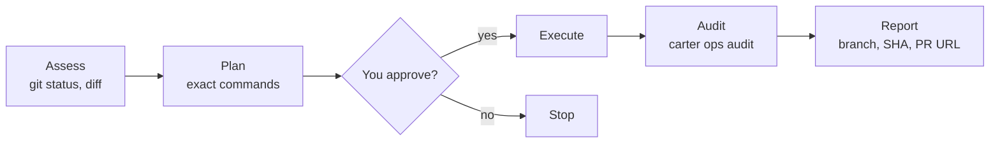

# Write operations (`ops:`)

Start a request with `ops:` and Carter follows a fixed approval flow for anything
that changes Git, GitHub or Jira: it shows you the exact commands first and runs
them only after you agree.

```text
ops: create a feature branch, commit my changes and open a pull request
```

## The flow



1. **Assess.** The agent reads the current state (`git status`, `git diff`,
   `git log`). No approval needed.
2. **Plan.** It shows the operation, the files, the message and every command.
3. **Approve.** Nothing is written until you say yes.
4. **Execute.** It runs the commands in the terminal, as you would.
5. **Audit.** It records the result with `carter ops audit`.
6. **Report.** It tells you what happened: branch, commit SHA, PR or issue URL.

Reads such as `git log` or `gh pr list` don't need `ops:`.

## Who runs which step

| Step | Who |
|------|-----|
| Local: branch, `git add`, `git commit` | The agent that received `ops:`. Maestro, Architect and Learner hold no local-write permission, so OpenCode asks you first |
| Remote: `git push`, PRs, issues, comments, releases | **DevOps only.** Other agents stop after the local steps and hand over |
| Jira writes (through the `carter-atlassian` MCP server) | DevOps, by the skill's routing. OpenCode asks you before every MCP call, in any agent |
| Text that leaves your machine (PR bodies, Jira comments, release notes) | Drafted by the Narrator, which removes secrets and internal details, then sent by DevOps |

OpenCode enforces the DevOps restriction only for shell commands: `git push` and the
`gh` write commands are denied to every other agent. Jira writes are MCP tool calls,
which have no specific rule: any agent could make one, but OpenCode asks you first.
Keeping them with DevOps, and the Narrator step, are instructions the agents follow;
see [the limits](safety-and-permissions.md#know-the-limits).

## Attribution

You stay the author of everything:

- **Commits** use your `git config user.name` and email and are signed with your key
  (`git commit -S`). Carter is credited only with a trailer:

  ```bash
  git commit -S -m "feat(auth): add token refresh" \
    --trailer "Co-authored-by: carter-bot <carter-bot@users.noreply.github.com>"
  ```

  Carter never uses `--author`. If signing fails, the agent asks whether to continue
  without signing.
- **GitHub** issues, PRs and comments are posted with your `gh` login and end with
  the footer `_This was generated by carter-bot._`
- **Jira** comments are written through the `carter-atlassian`
  [MCP server](mcp-servers.md), with your Atlassian login, and end with
  `_This comment was generated by carter-bot._`

Commit messages, branch names and PR text are always in English, whatever language
you chat in.

## Setup

`carter install` creates `~/.carter/config.toml` the first time (it never overwrites
it later):

```toml
[attribution]
# Co-author identity: credited via a `Co-authored-by:` trailer on commits
# (you stay the author) and in GitHub/Jira footers.
name = "carter-bot"
email = "carter-bot@users.noreply.github.com"
footer = "This comment was generated by carter-bot."

[git]
signing_key = ""
```

- Choose another co-author name on the **first** install with
  `carter install --bot-name acme-bot`. The email becomes
  `acme-bot@users.noreply.github.com`. Later installs never overwrite
  `config.toml`, so `--bot-name` has no effect then: edit `[attribution]` in
  `~/.carter/config.toml` and re-run `carter install` (the `ops:` skill embeds these
  values).
- `signing_key` is filled from `git config user.signingkey` when it is set. If it is
  empty, Carter falls back to `~/.ssh/id_ed25519`, then `~/.ssh/id_rsa`.
- GitHub writes use `gh`, so log in with `gh auth login` first.

> [!WARNING]
> `gh` uses `GH_TOKEN` or `GITHUB_TOKEN` from the environment instead of your
> `gh auth login` credentials (`gh help environment`). If you export `GITHUB_TOKEN`
> for the [GitHub MCP server](mcp-servers.md), `gh` writes use that token too. Give it
> the write scopes you need, or don't export it globally (set it only for the
> environment that starts OpenCode).

To see the values the agents use:

```bash
carter ops config --emit
```

```json
{
  "bot_name": "carter-bot",
  "bot_email": "carter-bot@users.noreply.github.com",
  "signing_key": "",
  "footer": "This comment was generated by carter-bot.",
  "has_github_token": false
}
```

## Audit log

Every operation and every recorded [policy exception](safety-and-permissions.md#record-an-exception)
is appended to `~/.carter/audit.log`, one JSON object per line:

```json
{"timestamp": "2026-10-25T12:06:06.496537+00:00", "operation": "git-flow", "phase": "execute", "result": "success", "params": {"branch": "feature/x"}}
```

Logging is best-effort; a failed write never blocks the operation. Your Git, GitHub
and Jira history remain the real record. The command details are in the
[CLI reference](../reference/cli.md#carter-ops).

## Next

- [Safety and permissions](safety-and-permissions.md)
- [MCP servers](mcp-servers.md)
